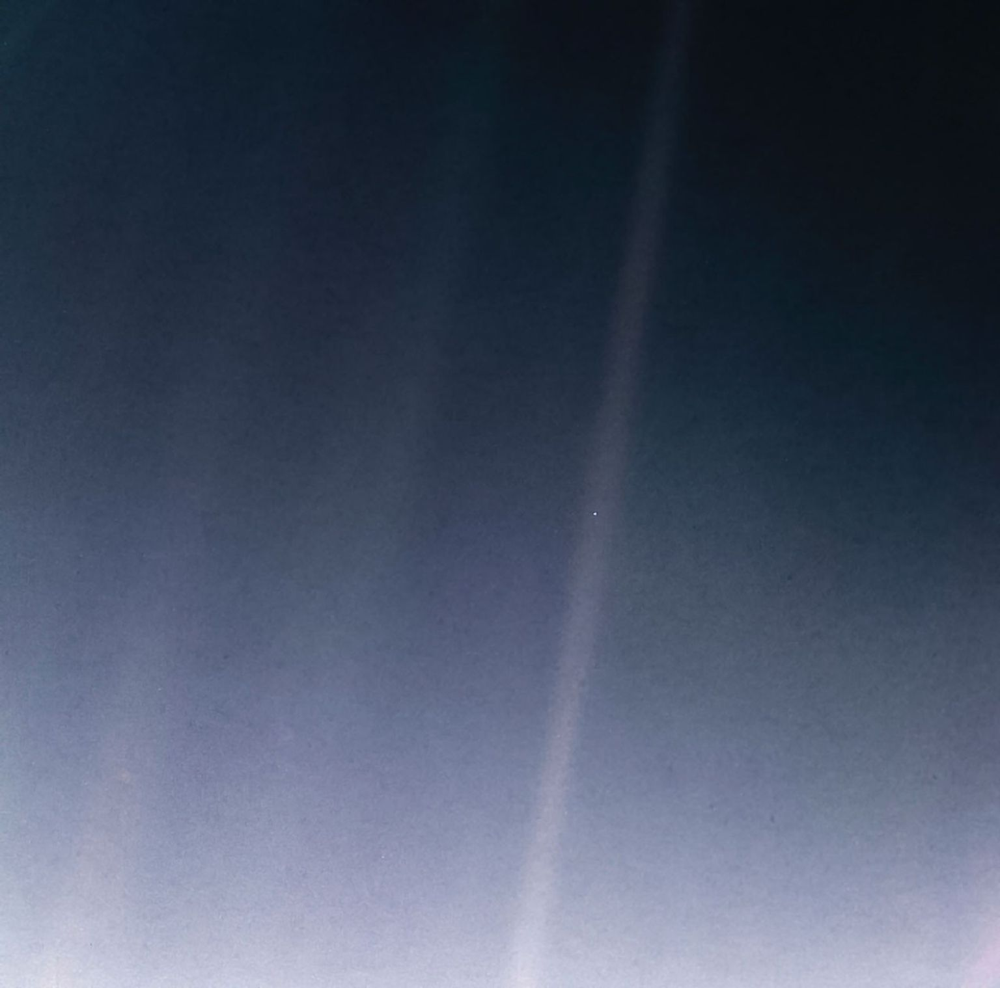
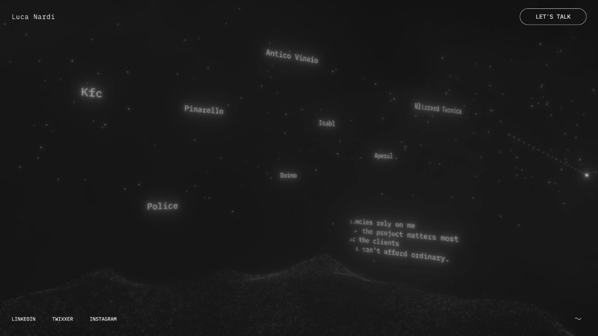
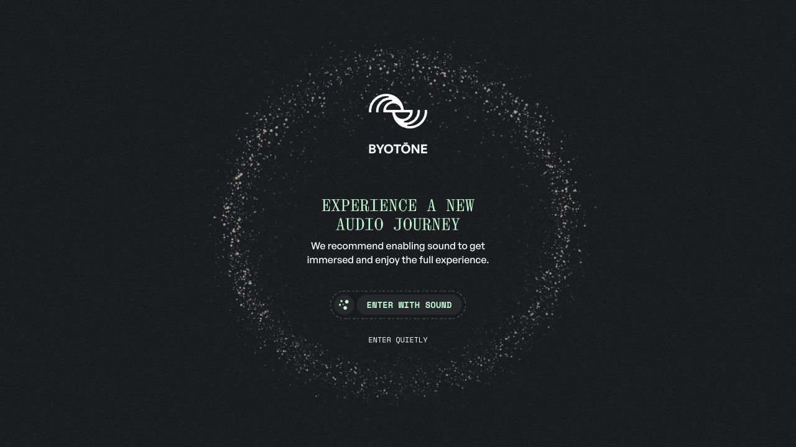

# 상상 속 행성까지

Network Media 기말 프로젝트 기획안 · 20211549 안현석

## 프로젝트 목표와 제작 동기

지구에서 출발해 영화와 소설 속 일곱 천체를 찾아가는 3D 웹 시뮬레이션을 만든다. 사용자는 작품 속 천체를 찾아 나선 탐험자가 되어 1인칭 시점으로 이동한다. 비행 중에는 천체 사이의 크기와 거리 차이를 체감하고, 도착하면 조명, 소리, 시간처럼 그곳의 환경을 설명하는 요소를 직접 조작한다. 작품을 처음 접하는 사람도 출발해서 도착하기까지의 흐름을 따라갈 수 있도록 설계한다.

1990년 보이저 1호가 멀리서 돌아본 지구는 사진 속에서 겨우 한 점으로 보인다. 이 사진과 칼 세이건의 《창백한 푸른 점》에서 출발해, 영화와 소설 속 익숙한 천체까지의 거리를 화면 속 이동, 바뀌는 축척, 신호를 기다리는 시간으로 체감하도록 한다.

*창백한 푸른 점. 보이저 1호 촬영(1990), NASA/JPL-Caltech 재처리본(2020).*

그 작은 점 안에서 사람들은 땅과 권력을 두고 싸우고 서로에게 폭력을 가한다. 멀리서 지구를 돌아보면, 그토록 중요하다고 여겨 싸워 온 것들은 얼마나 중요해 보일까? 다른 천체에서 생명과 환경을 관찰하는 경험을 통해, 같은 행성에 사는 우리가 서로를 어떻게 대하고 싶은지 생각해 보게 하는 것이 이 프로젝트의 목표다.

## 탐사 흐름과 웹 디자인

1. **지구에서 출발한다.** 첫 화면에서 지구와 태양 사이를 1cm로 줄인 축척을 제시한다. 같은 축척으로 판도라의 기준점인 알파 센타우리 A까지는 약 2.8km다. 스크롤하면 카메라가 지구에서 물러나 달과 태양계를 지나 B612로 이어진다. 가까운 항성계와 2.8km 비교 축척은 B612 탐사 기록에서 열 수 있다. [NASA 태양계 거리 자료](https://science.nasa.gov/learn/basics-of-space-flight/chapter1-1/) · [NASA 알파 센타우리 자료](https://solarsystem.nasa.gov/solar-system/sun/in-depth.amp)
2. **목적지를 고르고 비행한다.** 첫 목적지인 B612 이후에는 멀리서 지구와 일곱 천체가 한눈에 들어오는 3D 항로를 보고, 천체를 눌러 목적지를 고른다. 처음 둘러보는 사람에게는 공개세미나의 순서를 따라 `판도라 → 아드리안 → 에리드 → 아라키스 → 밀러 → 타투인`을 추천한다. 목적지를 확정하면 현재 천체 가까이에서 시작한다. 스크롤로 멀어지며 주변 천체와 항로를 보고, 마지막 시점에서 먼 점으로 보이는 목적지를 향해 자동 항해한다. 먼 점은 접근할수록 같은 천체의 윤곽과 표면으로 커진다. 상대적으로 긴 항로는 순항을 길게 두고 계기판에 항해 연출 시간과 거리 기준을 표시한다. 작품마다 등장하는 이동수단에서 관측창이나 계기판의 형태를 참고해 항로별 분위기를 바꾼다. 판도라 항로에서는 지구에서 인사를 보내는 버튼을 누를 수 있다. 전파가 도착하는 데 약 4.4년, 상대가 즉시 답장을 보내도 지구에서 받기까지 발신 후 약 8.7년이 걸린다. 비행 화면의 달력이 이 시간을 빠르게 넘겨 보여준다. [아바타 공식 판도라 설정](https://www.avatar.com/pandorapedia/pandora)
3. **도착해서 환경을 조작한다.** 목적지에 도착하면 그곳의 분위기에 맞춰 음악과 환경음이 바뀌고, 관찰할 대상이 표시된다. B612에서는 소행성 주위를 살펴 장미를 찾고 유리 덮개를 씌운다. 탐사 기록에는 관찰 결과와 방금 본 장면을 현실에 비춰 보는 설명을 남긴다. B612에서는 “이 작은 소행성에 장미가 자랄 공기가 머물 수 있을까?”라는 질문과 함께 소행성의 중력과 대기를 설명한다.

### 단계별로 지구 돌아보기

사용자는 각 구간에서 같은 ‘지구 돌아보기’ 버튼을 누른다. 카메라가 지구 쪽으로 돌아가고, 관찰을 마치면 진행하던 항로로 돌아간다.

| 시점 | 돌아봤을 때 보이는 지구 |
| --- | --- |
| **달을 지날 때** | 출발 화면을 채웠던 지구가 대륙과 구름이 보이는 작은 원반으로 줄어든다. |
| **태양계 바깥으로 향할 때** | 지구 표면의 모습이 사라지고 빛 속에 작은 푸른 점만 남는다. 보이저 1호 사진의 구도를 참고한다. |
| **다른 천체를 탐사한 뒤** | 조종석의 항법 화면에서 지구의 방향을 다시 찾는다. 탐사 기록 옆에 지구를 푸른 점으로 표시한다. |
| **일곱 곳을 탐사한 뒤** | 출발할 때 화면을 채웠던 지구를 다시 보여준다. 카메라가 물러나 지구가 푸른 점으로 작아지면 “이 작은 점에 함께 사는 우리는 서로를 어떻게 대하고 싶은가?”라는 질문을 띄운다. |

### 웹 디자인 레퍼런스

**About Luca.** 화면을 채우는 입자 질감을 참고해 천체 사이를 이동할 때 보이는 배경과 스쳐 지나가는 물체를 추상적으로 표현한다. 가까운 입자는 빠르게 스쳐 가고 먼 입자는 천천히 흐르도록 움직임에 차이를 두어, 이동 속도와 공간의 깊이를 느낄 수 있게 한다. [원본 사이트](https://www.aboutluca.com/?ref=landing.love) · [이미지 출처 · landing.love](https://www.landing.love/sites/aboutluca/)

**Byotōne.** 입장 전 소리 사용 여부를 선택하는 방식을 탐사 시작 화면에 적용한다. 작품 OST는 사용 가능 여부를 확인한 뒤 배경음 후보로 검토한다. 에리드에서는 소리를 끈 상태에서도 물체의 윤곽으로 반향을 확인할 수 있게 한다. [이미지 출처 · Byotōne](https://byotone.com/?ref=landing.love)

**상단 비행 단계 표시.** Byotōne의 상단처럼 원형 노드를 선으로 이어 현재 항로의 단계를 보여준다. 지나온 단계는 테두리 색으로 표시하고, 현재 노드는 색을 채운 뒤 아래에 단계 이름을 띄운다. 예를 들어 B612 항로에서 달에 가까워지면 현재 노드 아래에 ‘달 접근’이 표시된다.

## 목적지별 3D 인터랙션

| 천체 · 작품 | 거리 표시의 기준 | 사용자가 해보는 행동 |
| --- | --- | --- |
| **B612** · 《어린 왕자》 | 거리 미상 | 소행성 주위를 돌며 바오밥 싹을 뽑고 장미를 찾아 유리 덮개를 씌운다. |
| **판도라** · 《아바타》 | 알파 센타우리 A까지 약 4.37광년 | 빛나는 밤의 숲을 보고, 고개를 들어 폴리페무스를 찾고 판도라가 그 주위를 도는 모습을 확인한다. |
| **아드리안** · 《프로젝트 헤일메리》 | 타우 세티까지 약 11.9광년 | 적외선으로 페트로바 선을 찾아 아드리안에 접근한다. 그 지점에서 대기 샘플을 채취하고 확대한다. |
| **에리드** · 《프로젝트 헤일메리》 | 에리다누스자리 40 항성계까지 약 16광년 | 반향으로 어둠 속 물체를 찾고, 반향이 멎은 뒤 들려온 세 음에 같은 순서로 답한다. |
| **아라키스** · 《듄》 | 원작 부록에 나오는 모항성 카노푸스 | 스틸수트 점검 뒤 사막에서 두 길의 물 회수량과 예상 잔량을 비교하고 이동한다. |
| **밀러** · 《인터스텔라》 | 작품 속 웜홀 경로 | 파도와 두 시계를 보며 원하는 순간에 출발한다. 체류 시간과 관측한 파도 장면을 기록한다. |
| **타투인** · 《스타워즈》 | 거리 미상 | 두 해의 일몰과 그림자를 관찰한 뒤, 궤도에서 두 별과 공통 질량 중심을 확인한다. |

실재하는 항성까지의 관측 거리는 화면에 항성명과 함께 표시한다. 거리가 알려지지 않은 목적지에는 거리 미상을 표시하고 가상 항로로 들어간다. [NASA 《프로젝트 헤일메리》 해설](https://science.nasa.gov/the-science-behind-project-hail-mary/) · [NASA 근방 항성 거리 자료](https://spacemath.gsfc.nasa.gov/stars/5Page29.pdf) · [《듄》 원작 부록](https://duneworld.org/books/terms1.html) · [킵 손의 《인터스텔라》 해설](https://www.its.caltech.edu/~kip/index.html/PubScans/VI-59.pdf) · [《어린 왕자》 공식 사이트](https://www.lepetitprince.com/en/new-products-from-our-licensees/cutebee-unveils-two-book-nooks-inspired-by-the-little-prince/) · [스타워즈 공식 타투인 설정](https://www.starwars.com/databank/Tatooine)

탐사 기록에는 작품에서 재현한 관찰과 현실의 비교 근거를 함께 읽을 수 있게 한다. 아드리안의 미생물 형상에는 `작품을 바탕으로 재현한 샘플`을 표시한다. 타투인에서는 두 해와 그림자를 관찰한 뒤 두 별을 공전하는 가스 행성 케플러-16b를 소개한다. [NASA 베누 자료](https://science.nasa.gov/solar-system/asteroids/101955-bennu/facts/) · [NASA 케플러-16b 자료](https://science.nasa.gov/exoplanets/other-stars-other-worlds/kepler-16-b-almost-a-real-life-tatooine/)

참고 · 박서연, 〈지구 밖 여행 안내 — 여행지: 작품 속 천체들〉, 11월 11일 우주탐구회 공개세미나 발표자료 및 대본.

## 예상 기술 구현

- **공통 비행 화면.** 현재 Three.js/WebGL 프로토타입은 지구에서 달을 지나 B612에 접근하는 카메라 경로와 도착 후 회전·확대를 지원한다. 이를 바탕으로 스크롤 진행률을 카메라 경로에 연결하고, 지구 근처·태양계·항성계 구간별로 렌더링 축척을 바꾼다. 거리와 전파 이동 시간은 화면상의 좌표와 독립적으로 계산한다. 조종석 3D 모델과 계기판은 공통으로 사용하고, 목적지에 맞춰 관측창이나 내부 요소를 바꾼다.
- **목적지별 장면.** HTML/CSS와 JavaScript로 목적지 선택과 조작 버튼을 만들고, 천체 데이터에 작품명·거리 기준·출처·도착 장면을 연결한다. Three.js에서 포인터로 3D 물체를 선택하거나 슬라이더로 조명과 시간을 바꾸고, Web Audio API로 천체별 음악과 환경음을 전환하고 에리드의 반향을 재생한다. 각 장면은 선택할 때 불러온다.
- **제작 및 검증.** 지구에서 B612까지의 조종석 비행과 장미 관찰을 연결하고, 달을 지날 때와 B612 탐사 후의 돌아보기부터 구현한다. 비행 중 돌아보기를 누르면 진행 위치를 저장해 같은 지점에서 이어갈 수 있게 한다. 나머지 항로로 확장한 뒤, 시연에서는 지구가 작아지는 과정이 거리 감각과 지구를 바라보는 관점에 어떤 영향을 주었는지 묻는다.
